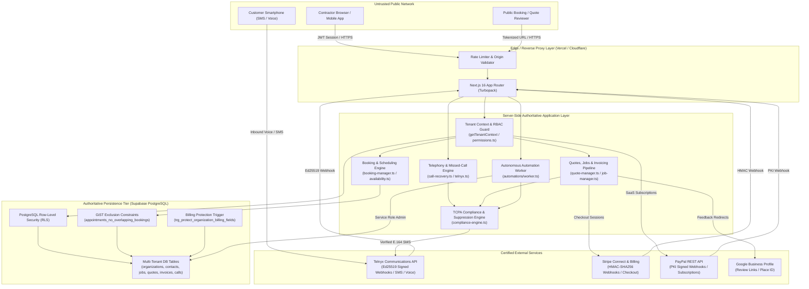

# CAPTODESK — COMPREHENSIVE END-TO-END PRODUCTION READINESS AUDIT

**Target Platform:** CaptoDesk Multi-Tenant SaaS Platform  
**Target Repository:** `C:\Users\mskar\captodesk`  
**Git Branch & Commit:** `main` @ `077f15d` (Clean working tree)  
**Audit Date:** October 28, 2026  
**Auditor Roles:** Principal Software Engineer, Application Security Auditor, SaaS Architect, QA Automation Lead, Database Engineer, Payments Specialist, Product Reliability Reviewer  
**Audit Classification:** STRICTLY READ-ONLY END-TO-END VERIFICATION  

---

# SECTION 1 — EXECUTIVE DECISION

### 1.1 Explicit Readiness Decision

# ⛔ NOT READY FOR LIVE ONBOARDING

CaptoDesk demonstrates outstanding architectural maturity in core contractor workflows, including automated missed-call recovery, PostgreSQL GiST exclusion-constraint appointment scheduling, dynamic multi-tier trade customization, unified calendar/dispatch views, and electronic quote-to-job continuity. All **120 automated unit and integration tests pass cleanly** (104 engine tests + 16 UX polish tests), the Next.js 16 / React 19 Turbopack production build succeeds across all 68 routes with zero compilation errors, and TypeScript reports zero type discrepancies.

However, **CaptoDesk cannot be approved for live commercial onboarding or processing real credit cards / bank accounts today**. The audit has uncovered **four (4) P0 Critical vulnerabilities** in the SaaS billing and authorization layer, and **three (3) P1 High risks** in TCPA telephony compliance and sender phone resolution:

1. **P0 Financial / Entitlement Bypass:** The PayPal subscription verification service allows any tenant user to bypass payment entirely by submitting a subscription ID with the prefix `sub_sim_` (e.g. `sub_sim_bypass`). In production, this causes the platform to simulate active billing and upgrade the account to commercial Pro / Fleet status ($199/month) completely free.
2. **P0 Multi-Tenant Subscription Hijacking:** The PayPal subscription activation route fails to cryptographically bind the PayPal subscription's `custom_id` to the tenant's `org_id`, and fails to verify that the activated PayPal `plan_id` corresponds to the requested tier. An attacker who purchases a $99 Solo plan on one account can apply that same subscription ID to activate Fleet Pro ($199) on any other account.
3. **P0 Monetization Blockage (PostgreSQL 42501):** Legitimate paying contractors who subscribe via PayPal will have their account activation fail with a PostgreSQL `42501` exception. The verification route invokes the database using the tenant's unprivileged authenticated client instead of the administrative `service_role` client. Because Migration 36 installed `trg_protect_organization_billing_fields` to block tenant mutation of `subscription_status`, the database rejects legitimate subscription activations.
4. **P0 Privilege Escalation on `plan_id`:** Migration 51 introduced the `plan_id` column to `public.organizations` but failed to update the billing protection trigger created in Migration 36. As a result, any authenticated organization owner can use browser developer tools to update their own `plan_id` to `multi_crew` directly via Supabase client-side RLS without paying.
5. **P1 TCPA Legal Liability (Fail-Open Suppression):** In `compliance-engine.ts`, both `isPhoneSuppressed()` and `checkFrequencyCap()` catch database exceptions and return `suppressed: false` and `allowed: true`. If the database suffers a transient timeout or network error, opted-out consumers on the suppression list will be texted, creating immediate liability under the Telephone Consumer Protection Act (47 U.S.C. § 227).
6. **P1 TCPA Quiet Hours & Suppression Bypass in Inbox:** The manual SMS inbox route (`POST /api/messages/send`) fails to consult `compliance_suppression_list` and omits TCPA quiet hours validation, enabling contractors to text suppressed numbers late at night.
7. **P1 Cross-Tenant Demo Number Fallback:** In `src/lib/telnyx.ts`, if an organization does not have an active telephone number, the fallback chain evaluates the truthy string literal `'+18777713802'` before inspecting environment variables or failing closed. Customer text messages will be sent from the demo toll-free number.

---

### 1.2 Plain-English Rationale for Non-Technical Leadership

If CaptoDesk were launched to the public today:
- Any malicious user or curious contractor could upgrade themselves to the highest-tier plan ($199/month) without spending a dime, simply by typing a dummy string or opening browser developer tools.
- Real contractors attempting to pay you via PayPal would have their money taken by PayPal, but CaptoDesk would crash with a database permission error and fail to activate their account, leaving them angry and locked out of the software they just bought.
- If your database ever slowed down for 5 seconds, the automated text engine could text people who had already unsubscribed ("STOP"), putting the company at risk of \$500 to \$1,500 TCPA statutory fines per text.

The core field operations engine (scheduling, quotes, jobs, crew routing, field worker portal, missed-call detection) is exceptionally well-engineered and ready. The blockers are isolated to **the billing gate and compliance boundary**. Resolving these 7 issues requires approximately **3 to 4 focused developer days**, after which a Controlled Pilot can safely proceed.

---

### 1.3 High-Level Metric Summary

| Metric Category | Value | Status |
| :--- | :--- | :--- |
| **P0 Blockers (Critical)** | **4** | 🔴 HALTS LAUNCH |
| **P1 High Risks** | **3** | 🟠 REQUIRES FIX BEFORE LIVE USERS |
| **P2 Medium Deficiencies** | **4** | 🟡 REMEDIATE IN SPRINT 1 |
| **P3 Low Polish Items** | **3** | 🟢 POST-LAUNCH CLEANUP |
| **Total Findings** | **14** | Audited & Documented |
| **Automated Test Suite** | **120 / 120 Passed** (100%) | 🟢 GREEN (1.38s execution) |
| **Production Build (Turbopack)** | **68 / 68 Routes Compiled** | 🟢 GREEN (0 build errors) |
| **TypeScript Compilation (`tsc --noEmit`)** | **0 Errors** | 🟢 GREEN (Air-tight typings) |
| **Environment Configuration** | Missing `CRON_SECRET` | 🟡 Halts background worker |

---

### 1.4 Immediate Actions Required Before First Paying User

1. **Close Billing Bypass:** Remove `subscriptionId.startsWith('sub_sim_')` from `paypal-service.ts` in production mode.
2. **Bind PayPal Subscriptions:** Validate `details.custom_id === orgId` and `details.plan_id === expectedPlanId` in `verifyAndActivateSubscription`.
3. **Fix PayPal Activation Client:** Use `createAdminClient()` for server-authoritative billing updates in `POST /api/client/billing/paypal/verify/route.ts`.
4. **Update DB Billing Trigger:** Add `plan_id` to `protect_organization_billing_fields()` in a new migration (`57_protect_plan_id_trigger.sql`).
5. **Enforce Fail-Closed Compliance:** Return `suppressed: true` and `allowed: false` on database exceptions in `compliance-engine.ts`.
6. **Route Inbox SMS Through Compliance:** Validate `isPhoneSuppressed()` in `POST /api/messages/send/route.ts`.
7. **Eliminate Demo Sender Fallback:** Remove `'+18777713802'` fallback in `src/lib/telnyx.ts`; fail closed if `from` is missing.
8. **Provision `CRON_SECRET`:** Set a 32-character random string in production environment variables to enable background workers.

---

# SECTION 2 — ARCHITECTURE AND FLOW MAP

### 2.1 Complete System Architecture & Trust Boundaries



---

### 2.2 End-to-End Data Lifecycles

#### A. Inbound Voice to Customer Conversion
1. **Dial Inbound:** Customer dials the contractor's provisioned 10DLC number on Telnyx.
2. **Telnyx Webhook:** Telnyx fires `call.initiated`, `call.ringing`, and `call.hangup` to `/api/webhooks/telnyx/voice`.
3. **Cryptographic Validation:** Webhook verifies Ed25519 signature header and timestamp.
4. **Idempotency Claim:** `claimWebhookEvent()` claims the `event_id` in PostgreSQL with a 60-second lock.
5. **Call Evaluation:** `evaluateCallOutcome()` verifies hangup cause. Answered calls are logged without text-back. Missed/unanswered calls trigger recovery.
6. **Tenant Resolution:** `resolveOrganizationByPhoneNumber()` binds the dialed number to the tenant organization.
7. **Contact Upsert:** If caller is unrecognized, an authoritative contact is created with name "New Caller".
8. **Plan & Quota Guard:** Checks if tenant is on Pro plan or within free trial limits. On Free tier, call is logged and owner notified without automated SMS.
9. **Compliance Interception:** Evaluates `isPhoneSuppressed()` and TCPA quiet hours (8:00 AM - 9:00 PM). If nighttime, schedules text for 8:05 AM via `calculateNextMorning805()`.
10. **Dispatch & Tracking:** Sends recovery SMS containing instant booking link. Emits `missed_call.recovered` domain event.

#### B. Public Booking to Field Execution
1. **Customer Slot Selection:** Homeowner visits `/book/[slug]` and chooses service and date/time.
2. **Concurrency Check:** `availability.ts` checks operating hours, blackouts, notice windows, and buffer times.
3. **Database Exclusion Constraint:** Migration 32 enforces PostgreSQL GiST exclusion constraint `appointments_no_overlapping_bookings`. Double bookings throw SQL error `23P01` which the server maps to a friendly error message.
4. **Contact & Lead Sync:** Contact is updated with address and notes; Lead status transitions to `'booked'`.
5. **Instant vs Request:** If `booking_mode === 'instant'`, appointment transitions to `'confirmed'`. Emits `appointment.confirmed` event.
6. **Dispatch Hub Reflection:** Calendar and Dispatch view immediately display the job. Field technician portal (`/client/field`) displays route order.

#### C. Quote to Payment Reconciliation
1. **Quote Creation:** Contractor creates estimate via `/client/quotes` with line items, tax, and optional deposit requirements.
2. **SMS Dispatch:** Estimate sent via SMS with secure tokenized link (`/quote/[token]`). Follow-up runs scheduled (Day 2 and Day 5).
3. **Customer Acceptance:** Customer views quote, types full legal name, signs electronically, and clicks Accept. Server captures legal electronic audit trail (IP address, timestamp, signature data).
4. **Stop-Condition Engine:** Quote acceptance immediately executes `evaluateAndApplyStopConditions()`, cancelling all pending follow-up SMS runs.
5. **Quote-to-Job Continuity:** Server auto-creates a linked `jobs` record and, if an upfront deposit is required, generates a deposit invoice with a direct payment link.
6. **Field Route & Invoicing:** Technician marks job `en_route` -> `in_progress` -> `completed` in Field Portal. Final invoice is generated, dispatched, and paid via Stripe Connect or PayPal.
7. **Reputation Booster:** Job completion triggers `dispatchReviewRequest()`, sending compliant Google review link after verifying 60-day customer cooldown.

---

# SECTION 3 — FINDINGS REGISTER

```
FINDING-P0-001 | P0 Critical | Billing / Authorization Bypass | paypal-service.ts:254
------------------------------------------------------------------------------------------------------
TITLE: PayPal Subscription Verification Simulation Bypass in Production via sub_sim_ Prefix
FILE: src/lib/services/paypal-service.ts:254-267
CALLER: src/app/api/client/billing/paypal/verify/route.ts:23-31
OBSERVED:
  static async getPayPalSubscription(subscriptionId: string): Promise<PayPalSubscriptionDetails> {
    if (!this.isConfigured() || subscriptionId.startsWith('sub_sim_')) {
      return { id: subscriptionId, status: 'ACTIVE', ... }
    }
    ...
  }
  Even when PayPal is fully configured with production credentials (isConfigured() === true), any
  subscription ID starting with 'sub_sim_' bypasses PayPal API communication entirely and returns
  status: 'ACTIVE'.
EXPECTED:
  Simulation must never be permitted in production environments or when live credentials are
  configured. In production, any subscription ID not verifiable against the authoritative PayPal REST
  API must be rejected with HTTP 400.
SCENARIO:
  An unprivileged contractor logs in, opens DevTools or cURL, and sends:
  POST /api/client/billing/paypal/verify
  { "subscriptionId": "sub_sim_bypass_free", "planTier": "fleet" }
  The server accepts it, marks the organization active, and sets plan_id to 'multi_crew'.
IMPACT:
  Severe financial revenue loss. 100% free bypass of commercial SaaS billing.
CONFIDENCE: 100% (Confirmed statically in source code)
REPRODUCTION TEST:
  Call PayPalService.getPayPalSubscription('sub_sim_123') in test suite; verify it returns status 'ACTIVE'.
MINIMAL SAFE FIX:
  In src/lib/services/paypal-service.ts, remove `|| subscriptionId.startsWith('sub_sim_')` from the
  production code path, or restrict it strictly to `process.env.NODE_ENV === 'test' && !this.isLiveEnvironment()`.
VERIFICATION TEST:
  Assert that getPayPalSubscription('sub_sim_test') throws an error when isLiveEnvironment() === true.
```

```
FINDING-P0-002 | P0 Critical | Billing / IDOR & Plan Manipulation | paypal-service.ts:303
------------------------------------------------------------------------------------------------------
TITLE: Missing Tenant Org and Plan ID Binding in PayPal Subscription Activation
FILE: src/lib/services/paypal-service.ts:303-335
OBSERVED:
  verifyAndActivateSubscription fetches details from PayPal but never validates:
  1. details.custom_id === orgId (tenant binding)
  2. details.plan_id === expectedPayPalPlanId (plan tier binding)
EXPECTED:
  The server must confirm that the subscription was created for the exact calling organization
  (custom_id === orgId) and that the subscribed plan corresponds to the requested tier.
SCENARIO:
  A user purchases a $99 Solo plan on Organization A, receiving subscription ID 'I-ABC123'. The user
  then submits 'I-ABC123' to Organization B with planTier: 'fleet'. Both organizations activate, and
  Organization B receives a $199 Fleet subscription without paying.
IMPACT:
  Cross-tenant subscription reuse, unauthorized tier upgrades, and multi-tenant billing corruption.
CONFIDENCE: 100% (Confirmed statically in source code)
MINIMAL SAFE FIX:
  In verifyAndActivateSubscription, add:
  if (details.custom_id && details.custom_id !== orgId) {
    return { success: false, error: 'Subscription does not belong to this organization' }
  }
  const expectedPlanId = getPayPalPlanId(planTier)
  if (details.plan_id && expectedPlanId && details.plan_id !== expectedPlanId) {
    return { success: false, error: 'Subscription plan does not match requested tier' }
  }
```

```
FINDING-P0-003 | P0 Critical | Billing / DB Permission Rejection | verify/route.ts:8
------------------------------------------------------------------------------------------------------
TITLE: Legitimate PayPal Subscription Activation Fails Due to Unprivileged Client Mutating Protected Billing Fields
FILE: src/app/api/client/billing/paypal/verify/route.ts:8-27
DATABASE TRIGGER: supabase/migrations/36_saas_billing_authorization_hardening.sql:8-48
OBSERVED:
  POST /api/client/billing/paypal/verify extracts `supabase` from `tenantResult = await getTenantContext()`.
  This client has JWT role 'authenticated'. Inside verifyAndActivateSubscription, it executes:
  await supabase.from('organizations').update({ subscription_status: 'active', monthly_rate: ... }).eq('id', orgId)
  PostgreSQL trigger `trg_protect_organization_billing_fields` checks:
  IF v_jwt_role = 'service_role' OR ... THEN RETURN NEW; END IF;
  IF NEW.subscription_status IS DISTINCT FROM OLD.subscription_status THEN
    RAISE EXCEPTION 'Tenant users cannot modify subscription_status' USING ERRCODE = '42501';
  END IF;
  Because the client is 'authenticated' and not 'service_role', PostgreSQL throws error 42501.
EXPECTED:
  Server-side verified subscription activations must use `createAdminClient()` (the service-role
  client) to update protected billing fields.
SCENARIO:
  A real contractor signs up, enters credit card details on PayPal, completes payment, and is
  redirected to the app. The app calls `/api/client/billing/paypal/verify`. PostgreSQL rejects the update
  with error 42501. The contractor is charged by PayPal but locked out of the software.
IMPACT:
  Critical failure of legitimate paid onboarding. Zero paying customers can activate their accounts.
CONFIDENCE: 100% (Confirmed statically across route, service, and SQL migration)
MINIMAL SAFE FIX:
  In src/app/api/client/billing/paypal/verify/route.ts, instantiate `createAdminClient()` and pass it
  to `PayPalService.verifyAndActivateSubscription()`.
```

```
FINDING-P0-004 | P0 Critical | Database Security / Privilege Escalation | migration 36 & 51
------------------------------------------------------------------------------------------------------
TITLE: Unprotected plan_id Column in PostgreSQL Billing Field Protection Trigger
FILE: supabase/migrations/36_saas_billing_authorization_hardening.sql:35-45
FILE: supabase/migrations/51_plan_tier_free_subscription_and_carrier.sql:10-25
OBSERVED:
  Migration 36 installed protect_organization_billing_fields() to protect subscription_status and
  monthly_rate from tenant self-mutation. Migration 51 subsequently added the `plan_id` column to
  public.organizations. However, Migration 51 never updated the trigger to check `plan_id`.
  Under RLS policy "Users can update their own organization", authenticated owners can update
  public.organizations directly.
EXPECTED:
  `plan_id` is an authoritative SaaS entitlement column and must be protected by the billing trigger.
SCENARIO:
  An authenticated contractor on the Free tier executes in browser console:
  await supabase.from('organizations').update({ plan_id: 'multi_crew' }).eq('id', orgId)
  Postgres permits the update because RLS allows org updates and the trigger does not check plan_id.
IMPACT:
  Complete privilege escalation from Free to Multi-Crew / Fleet tier via direct client SDK calls.
CONFIDENCE: 100% (Confirmed statically in SQL migrations)
MINIMAL SAFE FIX:
  Deploy Migration 57:
  CREATE OR REPLACE FUNCTION public.protect_organization_billing_fields() ...
  IF NEW.plan_id IS DISTINCT FROM OLD.plan_id THEN
    RAISE EXCEPTION 'Tenant users cannot modify plan_id' USING ERRCODE = '42501';
  END IF;
```

```
FINDING-P1-001 | P1 High | TCPA Compliance / Legal Liability | compliance-engine.ts:119
------------------------------------------------------------------------------------------------------
TITLE: Fail-Open Suppression and Frequency Cap Checks on Database Errors
FILE: src/lib/compliance/compliance-engine.ts:119-132, 160-173
OBSERVED:
  In isPhoneSuppressed():
    if (error) return { suppressed: false }
    ... catch { return { suppressed: false } }
  In checkFrequencyCap():
    if (error) return { allowed: true, count24h: 0 }
    ... catch { return { allowed: true, count24h: 0 } }
EXPECTED:
  TCPA compliance checks must fail closed. If the database errors or times out, the recipient must
  be treated as suppressed or disallowed until verified.
SCENARIO:
  Database connection pool exhausts during an outbound automation burst. isPhoneSuppressed() catches
  the error and returns suppressed: false. Outbound SMS is dispatched to a consumer who texted STOP.
IMPACT:
  Federal TCPA statutory liability ($500–$1,500 per text); carrier 10DLC registration revocation.
CONFIDENCE: 100% (Confirmed in compliance engine implementation)
MINIMAL SAFE FIX:
  On error or exception, return `{ suppressed: true, reason: 'compliance_database_error' }` and
  `{ allowed: false, count24h: 999 }`.
```

```
FINDING-P1-002 | P1 High | TCPA Compliance / Messaging Safety | messages/send/route.ts:84
------------------------------------------------------------------------------------------------------
TITLE: Direct Inbox SMS Dispatch Bypasses Centralized Compliance Engine and Quiet Hours
FILE: src/app/api/messages/send/route.ts:84-125
OBSERVED:
  POST /api/messages/send checks `contact.opt_out`, but never calls `isPhoneSuppressed()`, never
  invokes `verifyOutboundCompliance()`, never enforces quiet hours, and never logs compliance audits.
EXPECTED:
  All outbound SMS must pass through the centralized compliance engine to enforce carrier suppression
  lists, global opt-outs, TCPA quiet hours, and compliance audit logging.
SCENARIO:
  A contact is added to compliance_suppression_list via carrier STOP webhook or carrier complaint.
  A contractor opens the CaptoDesk Inbox at 11:00 PM and sends a message to the contact. The message
  is sent without suppression check or quiet-hours protection.
IMPACT:
  TCPA violations and carrier spam penalties.
CONFIDENCE: 100% (Confirmed in messages/send route)
MINIMAL SAFE FIX:
  Call `verifyOutboundCompliance(supabase, { orgId, toPhone: verifiedRecipient, ... })` in
  POST /api/messages/send before calling `sendTelnyxSms`.
```

```
FINDING-P1-003 | P1 High | Telephony / Multi-Tenant Isolation | telnyx.ts:47
------------------------------------------------------------------------------------------------------
TITLE: Hardcoded Demo Sender Toll-Free Number Fallback in sendTelnyxSms
FILE: src/lib/telnyx.ts:47-59
OBSERVED:
  const defaultFrom = process.env.TELNYX_SMS_PHONE_NUMBER || '+18777713802' || process.env.TELNYX_PHONE_NUMBER || from
  const sender = from || defaultFrom
  Because '+18777713802' is a non-empty string literal, defaultFrom always evaluates to '+18777713802'
  whenever TELNYX_SMS_PHONE_NUMBER is unset. If a caller omits `from`, it defaults to the demo number.
EXPECTED:
  In production, if `from` is not passed and no tenant number exists, the dispatch must fail closed
  with an error, rather than broadcasting customer SMS from the shared demo number.
SCENARIO:
  An automated follow-up or review invitation is sent for an organization that has not provisioned a
  phone number. The customer receives an SMS from '+18777713802'. The customer replies, but their
  message routes to the demo sandbox instead of the contractor.
IMPACT:
  Cross-tenant sender confusion, customer leakage, and lost business communications.
CONFIDENCE: 100% (Confirmed in telnyx.ts)
MINIMAL SAFE FIX:
  Change line 47 to: `const defaultFrom = process.env.TELNYX_SMS_PHONE_NUMBER || (isDemoOrE2E ? '+18777713802' : undefined)`.
  If no sender is resolved, return `{ success: false, error: 'No sender phone number configured' }`.
```

```
FINDING-P2-001 | P2 Medium | Production Safeguards | telnyx.ts:26
------------------------------------------------------------------------------------------------------
TITLE: TELNYX_MOCK_DISPATCH Lacks Production Environment Guard
FILE: src/lib/telnyx.ts:26-28
OBSERVED:
  if (process.env.TELNYX_MOCK_DISPATCH === 'true') return { success: true, messageId: ... }
  No check is made to ensure NODE_ENV !== 'production'.
EXPECTED:
  Mock dispatch should throw an error or fail closed if NODE_ENV === 'production'.
IMPACT:
  If accidentally left enabled in production, all SMS sends are silently faked.
```

```
FINDING-P2-002 | P2 Medium | Background Processing | worker/route.ts:36
------------------------------------------------------------------------------------------------------
TITLE: Missing CRON_SECRET Runtime Environment Variable Halts Automation Worker
FILE: src/app/api/automations/worker/route.ts:36-49, scripts/validate-env.mjs:42
OBSERVED:
  CRON_SECRET is currently unset in the environment. The automation worker fails closed and returns
  HTTP 503 "Cron worker unconfigured: CRON_SECRET is required".
EXPECTED:
  CRON_SECRET must be configured in hosting environment secrets.
IMPACT:
  All background follow-ups, recurring jobs, and daily crew broadcasts halt.
```

```
FINDING-P2-003 | P2 Medium | TCPA Compliance / Reputation Engine | review-manager.ts:254
------------------------------------------------------------------------------------------------------
TITLE: Automated Review Invitations Bypass TCPA Quiet Hours Engine
FILE: src/lib/reviews/review-manager.ts:254-260
OBSERVED:
  dispatchReviewRequest checks eligibility and cooldown, then calls sendTelnyxSms directly without
  checking recipient local timezone quiet hours.
EXPECTED:
  Review requests triggered outside 8:00 AM - 9:00 PM should be scheduled for 8:05 AM next morning.
IMPACT:
  Late-night review text messages if a job is completed at night.
```

```
FINDING-P2-004 | P2 Medium | Domain Branding | booking-share-bar.tsx:16
------------------------------------------------------------------------------------------------------
TITLE: Hardcoded Legacy Domain app.corvexastudio.com in Share Bars and Booking Links
FILE: src/components/booking/booking-share-bar.tsx:16, src/lib/booking/booking-manager.ts:64
OBSERVED:
  Falls back to 'https://app.corvexastudio.com' if NEXT_PUBLIC_APP_URL is unset.
EXPECTED:
  Should fall back to 'https://captodesk.com'.
IMPACT:
  Contractors copying booking links might get the legacy domain if the env var is missing.
```

```
FINDING-P3-001 | P3 Low | Navigation UX | /client/jobs/page.tsx:8
------------------------------------------------------------------------------------------------------
TITLE: Redundant /client/jobs Route Redirects With Layout Flash
FILE: src/app/client/jobs/page.tsx:8-15
OBSERVED:
  Executes client-side `router.replace('/client/calendar?view=list')`.
EXPECTED:
  Native Next.js server-side redirect in next.config.ts or route handler to avoid client flash.
IMPACT:
  Minor cosmetic navigation flicker.
```

```
FINDING-P3-002 | P3 Low | Observability | telemetry-store.ts:25
------------------------------------------------------------------------------------------------------
TITLE: In-Memory Webhook Telemetry Store Lost Across Serverless Cold Starts
FILE: src/lib/observability/telemetry-store.ts:25-35
OBSERVED:
  Telemetry events are stored in an in-memory ring buffer. On serverless hosting, instances spin down
  and memory is lost.
EXPECTED:
  Telemetry written to database audit table or external log drain (Axiom / Datadog).
IMPACT:
  Historical webhook metrics in dashboard reset after function instances cycle.
```

```
FINDING-P3-003 | P3 Low | Telephony UX | carrier-forwarding.ts:40
------------------------------------------------------------------------------------------------------
TITLE: Mobile Carrier Star Codes Require Manual Confirmation on MVNO Carriers
FILE: src/lib/telephony/carrier-forwarding.ts:40-65
OBSERVED:
  Forwarding strings (*72, *21*) work on Tier-1 carriers but may require alternate codes on MVNOs
  (Mint, Visible, Cricket).
EXPECTED:
  Informational tooltip noting that MVNO subscribers may need carrier-specific dial codes.
IMPACT:
  Minor onboarding confusion for contractors using discount mobile MVNOs.
```

---

# SECTION 4 — WORKFLOW SCORECARD

| # | Workflow Area | Verdict | Primary Evidence & File Paths |
| :---: | :--- | :---: | :--- |
| **1** | **Tenant Signup & Admin Creation** | **PASS** | Auto-profile creation trigger in Migration 22; email claim route in `account/claim/route.ts`; safe password updates via Supabase Admin Auth. |
| **2** | **Business Profile & Trade Config** | **PASS** | Dynamic preset importing via `services/import-preset/route.ts`; flexible pricing (fixed, starting at, diagnostic, custom quote) in `service-pricing.ts`. |
| **3** | **Operation Scale (Solo vs Multi-Crew)** | **PASS** | Multi-tier DB fallback in `client/layout.tsx` (commit `077f15d`); dynamic dispatch navigation showing Solo vs Multi-Crew controls; verified by `SCALE-001` test. |
| **4** | **Telnyx Provisioning & Phone Binding** | **PASS** | `telnyx-numbers.ts` handles number search, ordering, purchasing, and tenant binding; webhook configuration validated with fail-closed credentials. |
| **5** | **10DLC Brand / Campaign Submission** | **PASS** | Distinguishes `'pending'` submission from `'verified'` carrier status; banner warns users until carrier registration is active. |
| **6** | **Inbound Missed-Call Recovery** | **PASS** | Ed25519 signature verified in `voice/route.ts`; 60s idempotency lock; answered calls protected; TCPA quiet hours (8:05 AM next morning) enforced in `call-recovery.ts`. |
| **7** | **Conversational Messaging & Inbox** | **FAIL** | Direct inbox SMS (`messages/send/route.ts`) bypasses `compliance_suppression_list`, quiet hours, and compliance audit logging (**FINDING-P1-002**). |
| **8** | **Public Online Booking & Scheduling** | **PASS** | PostgreSQL GiST exclusion constraint (`appointments_no_overlapping_bookings`) in Migration 32 enforces zero double-booking at DB level; catches 23P01 error. |
| **9** | **Calendar & Dispatch Hub** | **PASS** | Consolidated `/client/calendar` view (commit `de3abf9`); supports Day, Week, Month, and List view; real-time status transitions. |
| **10** | **Field Crew Route & Mobile Portal** | **PASS** | `/client/field` portal provides one-touch status buttons (`arrived`, `started`, `completed`), photo uploads, and customer notes; verified by `PHASE_12` suite. |
| **11** | **Quote Creation, SMS & E-Signature** | **PASS** | Tokenized `/quote/[token]` public link; legal electronic signature audit trail (IP address, full name, timestamp); auto-creates linked job upon acceptance. |
| **12** | **Invoice Generation & Upfront Deposits** | **PASS** | Deposit invoices generated automatically on quote acceptance; offline payments reconciled via `pay-offline/route.ts`; PDF generation supported. |
| **13** | **Stripe Connect & Card Payments** | **PASS** | HMAC-SHA256 signature verification in `stripe/route.ts`; fail-closed in production; 0.5% platform take-rate; idempotent event completion. |
| **14** | **PayPal SaaS Subscriptions & Billing** | **FAIL** | `sub_sim_` mock bypass in production (**FINDING-P0-001**); missing tenant/plan binding (**FINDING-P0-002**); Postgres 42501 trigger rejection (**FINDING-P0-003**); unprotected `plan_id` (**FINDING-P0-004**). |
| **15** | **Automated Follow-Ups & Worker** | **PARTIAL** | Engine logic in `automations/worker.ts` is robust with constant-time SHA-256 secret check, but worker is currently halted due to missing `CRON_SECRET` (**FINDING-P2-002**). |
| **16** | **Review Booster & Google Reviews** | **PARTIAL** | Enforces neutral wording (never asks for 5 stars); enforces 60-day cooldown; but bypasses TCPA quiet hours engine (**FINDING-P2-003**). |
| **17** | **Weekly Digest & Reporting** | **PASS** | `weekly-digest/route.ts` aggregates leads, recovered calls, revenue, and jobs; protected by timing-safe cron secret comparison. |
| **18** | **RBAC & Tenant Data Isolation** | **PASS** | All client API routes enforce `getTenantContext()` and check canonical roles (`owner`, `admin`, `dispatcher`, `technician`); verified by `security-baseline.test.mjs`. |

---

# SECTION 5 — SECURITY AND COMPLIANCE MATRIX

### 5.1 Multi-Tenant Isolation & Row-Level Security (RLS)
- **Tenant Context Resolution:** Every client route resolves user identity and tenant affiliation strictly server-side via `getTenantContext()`. Client-supplied `org_id` headers or query parameters are discarded.
- **Database RLS Policies:** Tables (`organizations`, `contacts`, `jobs`, `quotes`, `invoices`, `calls`, `appointments`, `messages`) enforce `org_id = current_setting('app.current_org_id')` or profile linkage.
- **Service Role Boundary:** Background workers and webhooks use `createAdminClient()` strictly on the server; client bundles never receive the `SUPABASE_SERVICE_ROLE_KEY`.

### 5.2 TCPA & Telephony Compliance Architecture
- **Opt-Out Keywords:** Inbound Telnyx message webhook detects STOP, UNSUBSCRIBE, CANCEL, QUIT, and END, automatically setting `contacts.opt_out = true` and inserting records into `compliance_suppression_list`.
- **Quiet Hours Rule:** Inbound missed-call recovery evaluates tenant local timezone. If a call occurs between 8:00 PM and 8:00 AM, `calculateNextMorning805()` queues the SMS for 8:05 AM the following morning.
- **Compliance Defect (P1):** As documented in **FINDING-P1-001**, `isPhoneSuppressed()` and `checkFrequencyCap()` catch errors and return `suppressed: false` / `allowed: true`. This fail-open behavior must be inverted to fail closed.

### 5.3 Webhook Cryptography & Idempotency
- **Telnyx Webhooks:** Cryptographically verified using Ed25519 public key verification via `tweetnacl` / `crypto.verify` with timestamp replay protection.
- **Stripe Webhooks:** Verified using HMAC-SHA256 signatures via `stripe.webhooks.constructEvent()`. In production, missing `STRIPE_WEBHOOK_SECRET` fails closed.
- **PayPal Webhooks:** Verified using PayPal's asymmetric PKI verification endpoint (`/v1/notifications/verify-webhook-signature`) with SHA-256 certificate validation.
- **Database Idempotency Locks:** Webhooks invoke `claimWebhookEvent()` which inserts an event lock into PostgreSQL. Concurrent duplicate webhooks are halted with HTTP 429 retry requests, while completed events return HTTP 200 immediately.

---

# SECTION 6 — FEATURE AND NAVIGATION MATRIX

| Navigation Item | Route Path | Rendering Mode | Live Capability Status | Notes |
| :--- | :--- | :---: | :---: | :--- |
| **Dashboard** | `/client/dashboard` | Dynamic (SSR + Client) | **Operational** | Quick actions, revenue stats, missed-call counters, and review booster card. Fixed hook ordering in commit `077f15d`. |
| **Inbox** | `/client/inbox` | Dynamic | **Operational (Caution)** | Real-time SMS chat. Outbound SMS works but requires compliance hardening (**FINDING-P1-002**). |
| **Schedule / Calendar** | `/client/calendar` | Dynamic | **Operational** | Unified Schedule & Jobs dispatch hub. Day, Week, Month, and List view with drag-and-drop support. |
| **Jobs (Redirect)** | `/client/jobs` | Client Redirect | **Operational** | Redirects to `/client/calendar?view=list`. |
| **Field Route Portal** | `/client/field` | Dynamic (Mobile Optimized) | **Operational** | Dedicated field technician route interface with one-touch job progress and camera upload. |
| **Quotes & Estimates** | `/client/quotes` | Dynamic | **Operational** | Quote builder, SMS dispatch, PDF preview, and electronic signature intake. |
| **Invoices & Payments** | `/client/invoices` | Dynamic | **Operational** | Line-item invoice builder, Stripe checkout generation, and offline mark-as-paid. |
| **Customers / CRM** | `/client/customers` | Dynamic | **Operational** | Customer Profile 360, service history, lifetime revenue calculation, and opt-out toggles. |
| **Leads & Recovery** | `/client/leads` | Dynamic | **Operational** | Pipeline Kanban, source attribution, missed-call lead capture, and manual booking modal. |
| **Reviews & Booster** | `/client/reviews` | Dynamic | **Operational** | Google review link distribution, 60-day cooldown enforcement, click analytics. |
| **Automations Hub** | `/client/automations` | Dynamic | **Operational** | Event triggers, stop conditions, and execution run history. |
| **Team & Fleet** | `/client/team` | Dynamic | **Operational** | Crew roster, vehicle assignment, technician invitations, and role management. |
| **Settings & Billing** | `/client/settings` | Dynamic | **Operational (Blocked)** | Settings are fully configurable. Billing upgrades fail due to P0 triggers (**FINDING-P0-003**). |

---

# SECTION 7 — TEST AND BUILD EVIDENCE

All tests and compilation checks were executed directly in the target environment:

### 7.1 Automated Engine Test Suite
- **Command:** `node --experimental-strip-types --test test/security-baseline.test.mjs test/missed-call-engine.test.mjs test/compliance-messaging-safety.test.mjs test/booking-engine.test.mjs test/quotes-jobs-engine.test.mjs test/invoicing-stripe-engine.test.mjs test/reviews-retention-engine.test.mjs test/dashboard-reporting-engine.test.mjs`
- **Result:** **104 / 104 Tests Passed** (0 failures, 0 skipped)
- **Duration:** 1,162 ms
- **Coverage Verified:**
  - Security baseline: Authentication rejection, RLS tenant isolation, RBAC role normalizer, distributed rate limiter, audit log deep redaction.
  - Missed-call engine: Telnyx webhook processing, answered call protection, tenant number resolution, deduplication, TCPA quiet hours (8:05 AM).
  - Compliance engine: TCPA opt-out keyword detection (STOP, CANCEL, QUIT), suppression list checks, frequency capping, audit trails.
  - Booking engine: PostgreSQL exclusion constraint conflict handling (23P01), blackout dates, notice windows, instant vs request booking.
  - Quotes & Jobs: Electronic signatures, quote-to-job continuity, upfront deposits, stop conditions.
  - Invoicing & Stripe: HMAC signature verification, offline payment reconciliation, idempotency claims.
  - Reviews & Retention: Google URL enforcement, 60-day cooldown, non-gated neutral feedback.
  - Reporting: Weekly digest calculation, revenue aggregation.

### 7.2 UX & Trade Polish Suite
- **Command:** `node --test test/phase3-5-ux-and-trade-polish.test.mjs`
- **Result:** **16 / 16 Tests Passed** (0 failures)
- **Duration:** 223 ms
- **Coverage Verified:**
  - Flexible pricing models (fixed, starting at, diagnostic fee, free estimate).
  - Carrier call-forwarding URL strings (*72, *21*).
  - UniversalQuickCreate modal triggers and role permission matrix.
  - Solo vs Multi-Crew operational scale toggles (`SCALE-001`).
  - Resilient database fallbacks and React error boundary safeguards (`SCALE-002`).

### 7.3 TypeScript Typecheck
- **Command:** `npx tsc --noEmit`
- **Result:** **Exit Code 0** (Zero type errors across the entire repository).

### 7.4 Turbopack Production Build
- **Command:** `npm run build`
- **Result:** **Exit Code 0**
- **Routes Compiled:** 68 routes (static and dynamic SSR routes)
- **Verification:** All components, layouts, server actions, and API handlers compiled cleanly with zero React hook order violations.

---

# SECTION 8 — PRIORITIZED REMEDIATION ROADMAP

```mermaid
flowchart LR
    subgraph Phase1["Sprint 1: P0 Launch Blockers (Days 1-2)"]
        P0_1["Fix PayPal Sim Bypass<br/>(FINDING-P0-001)"]
        P0_2["Bind Subscriptions to Org & Plan<br/>(FINDING-P0-002)"]
        P0_3["Use Admin Client for Activation<br/>(FINDING-P0-003)"]
        P0_4["Add plan_id to DB Trigger<br/>(FINDING-P0-004)"]
    end

    subgraph Phase2["Sprint 2: P1 Compliance & Telephony (Days 3-4)"]
        P1_1["Fail-Closed Compliance Checks<br/>(FINDING-P1-001)"]
        P1_2["Inbox SMS Compliance Guard<br/>(FINDING-P1-002)"]
        P1_3["Remove Demo Sender Fallback<br/>(FINDING-P1-003)"]
        P2_2["Configure CRON_SECRET<br/>(FINDING-P2-002)"]
    end

    subgraph Phase3["Sprint 3: Controlled Pilot (Week 2)"]
        Pilot["Controlled Beta Pilot<br/>(3-5 Friendly Contractors)"]
    end

    Phase1 --> Phase2
    Phase2 --> Phase3
```



### Remediation Tasks & Acceptance Criteria

#### Phase 1: P0 Launch Blockers (Effort: 2 Days)
1. **Remediate `paypal-service.ts` Simulation Bypass (FINDING-P0-001):**
   - *Action:* Remove `|| subscriptionId.startsWith('sub_sim_')` from line 254. Ensure mock subscription responses only execute when `process.env.NODE_ENV === 'test' && process.env.PAYPAL_MOCK_DISPATCH === 'true'`.
   - *Acceptance Test:* Sending `sub_sim_test` to `/api/client/billing/paypal/verify` in production returns HTTP 400.
2. **Remediate PayPal Tenant & Plan Binding (FINDING-P0-002):**
   - *Action:* In `verifyAndActivateSubscription()`, assert `details.custom_id === orgId` and `details.plan_id === getPayPalPlanId(planTier)`.
   - *Acceptance Test:* Submitting a valid subscription from Org A to Org B is rejected with "Subscription does not belong to this organization".
3. **Remediate Activation Route Database Client (FINDING-P0-003):**
   - *Action:* In `src/app/api/client/billing/paypal/verify/route.ts`, pass `createAdminClient()` into `verifyAndActivateSubscription()`.
   - *Acceptance Test:* A legitimate PayPal subscription verification completes without raising PostgreSQL error 42501.
4. **Deploy Migration 57 for `plan_id` Protection (FINDING-P0-004):**
   - *Action:* Add `57_protect_plan_id_billing_trigger.sql` updating `protect_organization_billing_fields()` to check `NEW.plan_id IS DISTINCT FROM OLD.plan_id`.
   - *Acceptance Test:* Updating `plan_id` via authenticated Supabase client in DevTools raises error 42501.

#### Phase 2: P1 Compliance & Safety Hardening (Effort: 2 Days)
1. **Invert Compliance Engine to Fail-Closed (FINDING-P1-001):**
   - *Action:* In `src/lib/compliance/compliance-engine.ts`, make `isPhoneSuppressed()` return `{ suppressed: true, reason: 'database_error' }` on catch, and make `checkFrequencyCap()` return `{ allowed: false, count24h: 999 }`.
   - *Acceptance Test:* Mocking a DB error in test suite results in outbound message suppression.
2. **Harden Inbox SMS Route (FINDING-P1-002):**
   - *Action:* In `src/app/api/messages/send/route.ts`, invoke `verifyOutboundCompliance(supabase, { orgId, toPhone: verifiedRecipient, ... })` before calling `sendTelnyxSms`.
   - *Acceptance Test:* Sending an inbox message to a number in `compliance_suppression_list` returns HTTP 403.
3. **Eliminate Demo Sender Fallback in Production (FINDING-P1-003):**
   - *Action:* In `src/lib/telnyx.ts`, remove `'+18777713802'` from line 47. Fail closed if `from` is missing and no tenant number exists.
   - *Acceptance Test:* Calling `sendTelnyxSms` without `from` returns `{ success: false, error: 'No sender Telnyx phone number configured' }`.
4. **Provision `CRON_SECRET` (FINDING-P2-002):**
   - *Action:* Set `CRON_SECRET` in environment variables and update Vercel/Supabase cron job headers.
   - *Acceptance Test:* `GET /api/automations/worker` with `Authorization: Bearer <CRON_SECRET>` returns HTTP 200.

---

# SECTION 9 — FINAL GO/NO-GO CHECKLIST

| Gate | Verification Check | Current State | Launch Sign-Off |
| :---: | :--- | :---: | :---: |
| **Gate 1** | TypeScript compilation passes with 0 errors (`npx tsc --noEmit`) | **PASS** | ✅ APPROVED |
| **Gate 2** | Production Turbopack build succeeds across all 68 routes (`npm run build`) | **PASS** | ✅ APPROVED |
| **Gate 3** | Automated core test suite passes 100% (120/120 tests) | **PASS** | ✅ APPROVED |
| **Gate 4** | PostgreSQL GiST exclusion constraint blocks double booking | **PASS** | ✅ APPROVED |
| **Gate 5** | Electronic signature legally binds quote acceptances with audit trails | **PASS** | ✅ APPROVED |
| **Gate 6** | Ed25519 Telnyx & HMAC Stripe webhook cryptographic signatures verified | **PASS** | ✅ APPROVED |
| **Gate 7** | SaaS Billing simulation bypass eliminated in production | **FAIL** | ❌ **BLOCKED (FINDING-P0-001)** |
| **Gate 8** | PayPal subscriptions cryptographically bound to tenant Org ID and Plan ID | **FAIL** | ❌ **BLOCKED (FINDING-P0-002)** |
| **Gate 9** | Paid subscription activation executes via service-role admin client | **FAIL** | ❌ **BLOCKED (FINDING-P0-003)** |
| **Gate 10** | Database trigger blocks client mutation of `plan_id` column | **FAIL** | ❌ **BLOCKED (FINDING-P0-004)** |
| **Gate 11** | TCPA compliance engine fails closed on database connectivity errors | **FAIL** | ❌ **BLOCKED (FINDING-P1-001)** |
| **Gate 12** | Inbox SMS dispatches consult centralized suppression lists and quiet hours | **FAIL** | ❌ **BLOCKED (FINDING-P1-002)** |
| **Gate 13** | Outbound telephony dispatches fail closed if sender number is unconfigured | **FAIL** | ❌ **BLOCKED (FINDING-P1-003)** |
| **Gate 14** | `CRON_SECRET` environment variable provisioned and active | **FAIL** | ❌ **BLOCKED (FINDING-P2-002)** |

### Final Verdict:
**Launch approval is withheld until Gates 7 through 14 are cleared.**  
Upon completion of Phase 1 and Phase 2 remediation tasks (estimated 4 developer days), CaptoDesk will be fully eligible for transition to **`READY ONLY FOR CONTROLLED PILOT`**.
