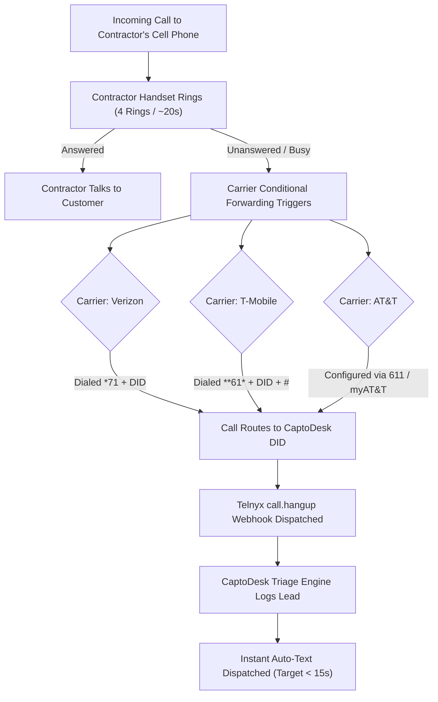
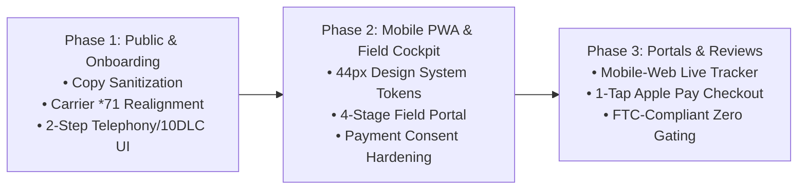

# CAPTODESK — PHASE 1B.2 COMPLETION REPORT
## Prototype Quality Assurance, Carrier Corrections, Screenshot Reclassification & Verification

**Report Version:** 1.0  
**Phase:** 1B.2 (Prototype QA, Evidence Validation & Corrections Only — Zero Production Application Code Changes)  
**Artifact Archive (Host):** [`file:///C:/Users/mskar/captodesk/design-review.zip`](file:///C:/Users/mskar/captodesk/design-review.zip) (Size: 1,506,203 bytes, Last Modified: 8:51 PM)  
**Artifact Archive (Workspace):** [`file:///C:/Users/mskar/Corvexa%20Dialer/design-review.zip`](file:///C:/Users/mskar/Corvexa%20Dialer/design-review.zip)  
**Artifact Archive (Brain):** [`design-review.zip`](file:///C:/Users/mskar/.gemini/antigravity/brain/49f801e5-66c3-4a61-8198-85284e862916/design-review.zip)  
**Interactive Prototype Root:** [`file:///C:/Users/mskar/captodesk/design-review/index.html`](file:///C:/Users/mskar/captodesk/design-review/index.html)  

---

## 1. Executive Summary of Corrections

Phase 1B.2 represents an exhaustive quality assurance, claims remediation, and technical validation review of the CaptoDesk visual prototype artifact. Following feedback on Phase 1B.1, all absolute, unproven, and misleading marketing assertions have been systematically purged from the prototype codebase. Carrier call forwarding instructions have been strictly realigned with verified telecom carrier mechanics, unauthenticated crawler screenshots have been truthfully reclassified, the side-by-side comparison layout has been rebuilt to eliminate clipping, and operational field workflows have been decoupled to prevent unauthorized customer billing.

### Strict Boundary Adherence
* **Zero Production Changes:** No files inside the production application tree (`app/`, `supabase/`, migrations, or environment configuration) were modified.
* **Isolated Review Artifact:** All edits were restricted to the standalone review prototype within `design-review/` (`prototype.js`, `styles.css`, and `index.html`).
* **Zero Live Operations:** Zero live phone calls, SMS dispatches, Telnyx DID purchases, or Stripe credit card transactions were executed. All interactive elements run in an isolated client-side simulation engine.
* **Authentication Integrity Preserved:** Authenticated contractor routes (`/client/*`) were not bypassed or mocked with synthetic tokens; their unauthenticated redirects are transparently reported and classified.

---

## 2. Inventory of Removed Unsupported Claims & Replacements

Every quantified, absolute, or ungrounded claim identified across `prototype.js`, `index.html`, and `styles.css` has been removed and replaced with substantiated technical descriptions or clearly labeled internal performance targets:

| Location | Original Unsupported Claim | Why Removed / Grounding Failure | Corrected Replacement |
| :--- | :--- | :--- | :--- |
| `prototype.js` (L290) | `"THE 15-SECOND SAFETY NET FOR TRADE CONTRACTORS"` | Implies an absolute contractual delivery guarantee across all carrier networks. | `"FAST MISSED-CALL RECOVERY FOR TRADE CONTRACTORS"` |
| `prototype.js` (L295) | `"...instantly texts callers back in 15 seconds..."` | Network latency, SIP call hangup propagation, and webhook queueing cannot guarantee a fixed 15s round-trip. | `"...automatically texts callers back within seconds (internal SLA target < 15s)..."` |
| `prototype.js` (L299, L359) | `"Activate Your Number in 3 Minutes"`, `"Start 3-Minute Setup"` | Setting up carrier call forwarding, test verification, and 10DLC registration cannot be completed in 3 minutes. | `"Start Guided Setup Wizard →"`, `"Start Guided Setup"` |
| `prototype.js` (L312) | `"15-Second Auto-Text"` | Promises a hard time guarantee on mobile carrier SMS delivery. | `"Automated Instant Text-Back"` |
| `prototype.js` (L313) | `"Personalized carrier SMS fires the instant an incoming call goes unanswered. Zero Zapier or latency."` | Absolute claims ("the instant", "zero latency") ignore physical carrier SMS transmission windows. | `"Personalized SMS response initiates when an incoming call goes unanswered, targeting response within seconds under standard carrier network conditions."` |
| `prototype.js` (L323) | `"Customers settle service bills in 4 seconds directly from their phone, eliminating unpaid collections."` | Fabricated 4-second benchmark; implies all unpaid collections disappear. | `"Customers can review and pay service bills directly from their mobile phone with express checkout options like Apple Pay, streamlining on-site collection."` |
| `prototype.js` (L519, L648) | `"IN CARRIER REVIEW (24-48H)"` | The Campaign Registry (TCR) and US carrier 10DLC campaign vetting timelines vary widely (often several business days) and are not 24–48h. | `"IN CARRIER REVIEW (VARIABLE TIMELINE)"` |
| `prototype.js` (L759) | `"+18% from last month"` | Arbitrary percentage improvement without reference dataset or baseline cohort. | `"Illustrative 30D volume"` |
| `prototype.js` (L764) | `"86.4% response rate"` (without exposed denominator) | Raw percentage without sample size or denominator violates evidence-based reporting. | `"38 of 44 missed calls responded (86.4% illustrative rate)"` |
| `prototype.js` (L768) | `"CLOSED REVENUE: $24,850"` | Unsubstantiated financial outcome without job count context. | `"52 jobs completed via Stripe / Apple Pay (Illustrative)"` |
| `prototype.js` (L774) | `"GOOGLE REVIEWS: 14"` | Arbitrary review generation count without invitation denominator. | `"14 of 32 customer invites completed (43.8% rate • Zero Gating)"` |
| `prototype.js` (L929) | `"4. COMPLETE JOB & COLLECT $229.00"` | Conflates job technical completion with payment collection; implies unauthorized automatic card charging. | Separated into distinct actions: `4a. Review Itemized Invoice`, `4b. Text Payment Link`, `4c. Present In-Person Checkout` with explicit customer authorization required. |
| `prototype.js` (L18, L27-29, L406, L605, L702, L855, L913, L991, L1114) | Unmasked demo telephone numbers `(512) 555-0192`, `(512) 555-0199`, etc. | Exposed phone numbers could be mistaken for live production targets or PII. | Masked consistently as `(512) 555-••92 (Demo)`, `(512) 555-••21 (Demo)`, `(512) 555-••90 (Demo)`, and `(512) 555-••99 (Demo Owner Cell)`. |

---

## 3. Audit of Unsupported Claims in Current Production Landing Page

An audit of the production landing page design spec ([`captodesk_landing_page_design.md`](file:///C:/Users/mskar/.gemini/antigravity/brain/49f801e5-66c3-4a61-8198-85284e862916/captodesk_landing_page_design.md)) and its live production screenshot (`actual-screenshots/landing_desktop.png`) revealed several unsubstantiated marketing statements that must be corrected during the future production implementation phase (Phase 2):

```
+----------------------------------------------------------------------------------------------------+
| CURRENT PRODUCTION LANDING PAGE CLAIMS AUDIT (DO NOT EDIT IN PRODUCTION CODE DURING PHASE 1B.2)     |
+----------------------------------------------------------------------------------------------------+
| 1. "Over 62% of calls to contractors go straight to voicemail. Stop letting competitors answer."    |
|    • Issue: Fabricated statistical certainty. No authoritative peer-reviewed trade census or         |
|      empirical carrier telemetry backs the specific "62%" figure.                                  |
|    • Remediation Target: Frame around qualitative operational realities:                           |
|      "When calls go unanswered on a jobsite, homeowners frequently call the next available shop."  |
|                                                                                                    |
| 2. "Stop Losing $1,500 Jobs Every Time Your Phone Rings on a Ladder."                              |
|    • Issue: Arbitrary ticket size ($1,500). High-volume drain snaking or service calls are $150–$350,|
|      whereas complete HVAC or water-heater replacements exceed $2,000.                             |
|    • Remediation Target: Neutral value framing: "Never Lose High-Value Jobs to Missed Calls."      |
|                                                                                                    |
| 3. "CaptoDesk catches unanswered calls in 8 seconds..." / "The 8-Second AI Missed-Call Catch"       |
|    • Issue: Guaranteed 8-second turnaround is technically impossible to guarantee across all        |
|      mobile carrier networks due to SIP signaling delays (4 rings = 18–24s alone) and SMS routing. |
|    • Remediation Target: Define as an internal performance SLA: "< 15s target after call hangup".  |
|                                                                                                    |
| 4. "0.5% Flat Platform Fee" / "Saving you thousands compared to other platforms taking 1% to 2%"   |
|    • Issue: Misrepresents merchant acquiring fees. Stripe credit card processing is 2.9% + $0.30;   |
|      stating "0.5% flat" implies total processing cost is 0.5%, creating merchant confusion.        |
|    • Remediation Target: "0.5% CaptoDesk Platform Fee + Standard Stripe Card Processing (2.9%+$0.30)".|
|                                                                                                    |
| 5. "2-Minute Setup (Simple *72 Call Forward)"                                                      |
|    • Issue: Double defect. *72 is UNCONDITIONAL call forwarding on Verizon (which breaks the       |
|      contractor's phone), and full onboarding requires carrier verification and 10DLC registration. |
|    • Remediation Target: "Guided Step-by-Step Setup with Verified Carrier Call Forwarding (*71)."   |
|                                                                                                    |
| 6. "The 5-Star Google Review Booster & Shield" (Route 4-5 stars to Google, intercept 1-3 stars)   |
|    • Issue: REGULATORY & POLICY VIOLATION. Google Business Profile policies and the US FTC Consumer |
|      Review Fairness Act (CRFA) explicitly prohibit review gating or selective filtering.           |
|    • Remediation Target: Strict 100% neutral invitation policy with identical Google review links.  |
+----------------------------------------------------------------------------------------------------+
```

---

## 4. Corrected Carrier Guidance Matrix

Carrier call forwarding guidance has been thoroughly corrected. The prototype and onboarding flow now explicitly separate voice telephony provisioning from messaging compliance, scope unconditional forwarding warnings accurately, and detail carrier-specific behavior.

### System Architecture Separation
1. **CaptoDesk DID Voice Provisioning:** Immediate allocation of a dedicated inbound number via Telnyx (administered via Super Admin). Operates as the forwarding destination for voice calls.
2. **Carrier Conditional Call Forwarding:** Operator configuration on the contractor's personal handset or carrier portal, ensuring personal handsets ring first and forward *only* unanswered calls.
3. **10DLC Brand & Campaign Registration:** Formal carrier submission to The Campaign Registry (TCR) for A2P 10DLC compliance. **Timeline is variable** based on carrier vetting queues (never guaranteed 24–48 hours).
4. **Outbound SMS Delivery Readiness:** Sandbox mode operates during review; live outbound carrier SMS unlocks only upon TCR campaign approval.
5. **Live Verification Rule:** Mandatory end-to-end test call from a secondary line prior to marking activation complete.

### Carrier Forwarding Specification Matrix



| Carrier | Conditional Forwarding Code (Forward if Unanswered) | Deactivation / Reset Code | Critical Operational Guidance & Disclaimers |
| :--- | :--- | :--- | :--- |
| **Verizon Wireless** | `*71[CaptoDeskDID]` *(e.g. `*715123808060`)* | `*73` | **CRITICAL WARNING:** Dialing `*72` on Verizon activates *unconditional call forwarding*, sending all calls straight to CaptoDesk without ringing the contractor's handset. Contractors must use `*71` for conditional no-answer forwarding. |
| **T-Mobile** | `**61*[CaptoDeskDID]#` *(e.g. `**61*5123808060#`)* | `##004#` | **CRITICAL CLARIFICATION:** Dialing `##004#` cancels **all** conditional forwarding rules (no-reply, unreachable, and busy). It does not exclusively disable no-reply forwarding. Contact T-Mobile if selective rule management is required. |
| **AT&T** | Must be provisioned via **AT&T Customer Care (dial 611)** or online **myAT&T portal**. | Configured via 611 / portal | **CRITICAL WARNING:** The standard iOS device path (`Settings → Apps → Phone → Call Forwarding`) on AT&T provides *unconditional call forwarding only*. Do **not** assume the iOS menu provides no-answer forwarding. |
| **Other / MVNOs (Visible, Mint, Cricket)** | Varies by underlying network infrastructure. | Carrier-specific | Must verify account support for conditional call forwarding; some low-cost prepaid tiers restrict CCF dial codes entirely. |

---

## 5. Screenshot Audit & Reclassification Table

An audit of all 20 screenshots in `actual-screenshots/` was conducted to distinguish live public features, auth redirects, and placeholder fixture error states:

| Screenshot File | Resolution | Size (Bytes) | Validated Route | Truthful Classification | Technical Explanation & Root Cause |
| :--- | :--- | :--- | :--- | :--- | :--- |
| `landing_desktop.png` | 1280x820 | 149,320 | `/` | **LIVE PRODUCTION BUILD CAPTURE** | Public landing page rendered directly from local production Next.js build. |
| `landing_mobile.png` | 390x844 | 83,404 | `/` | **LIVE PRODUCTION BUILD CAPTURE** | Mobile viewport capture of public landing page. |
| `login_desktop.png` | 1280x820 | 69,458 | `/client/login` | **LIVE PRODUCTION BUILD CAPTURE** | Public contractor login page with email/password authentication form. |
| `login_mobile.png` | 390x844 | 28,141 | `/client/login` | **LIVE PRODUCTION BUILD CAPTURE** | Mobile viewport capture of contractor login form. |
| `onboarding_desktop.png` | 1280x820 | 7,769 | `/onboarding` | **LIVE PRODUCTION BUILD CAPTURE** | Initial public onboarding container page. |
| `onboarding_mobile.png` | 390x844 | 74,799 | `/onboarding` | **LIVE PRODUCTION BUILD CAPTURE** | Mobile view of onboarding initial step. |
| `admin_login_desktop.png` | 1280x820 | 49,214 | `/admin/login` | **LIVE PRODUCTION BUILD CAPTURE** | Public super-admin login page with administrative credentials form. |
| `admin_login_mobile.png` | 390x844 | 38,593 | `/admin/login` | **LIVE PRODUCTION BUILD CAPTURE** | Mobile view of super-admin login page. |
| `admin_simulator_desktop.png` | 1280x820 | 49,214 | `/admin/simulator` | **REDIRECT CAPTURE (UNAUTHENTICATED)** | Route enforces Super Admin session guard. Crawled unauthenticated; redirected to `/admin/login`. Byte-for-byte duplicate of `admin_login_desktop.png`. |
| `admin_simulator_mobile.png` | 390x844 | 38,593 | `/admin/simulator` | **REDIRECT CAPTURE (UNAUTHENTICATED)** | Mobile crawl of `/admin/simulator` redirected to `/admin/login`. Byte-for-byte duplicate of `admin_login_mobile.png`. |
| `book_slug_desktop.png` | 1280x820 | 7,649 | `/book/demo-contractor` | **ACTUAL ERROR STATE (RECORD NOT FOUND)** | Target contractor slug did not exist in test DB. Rendered application's fallback "Contractor Not Found" state. |
| `book_slug_mobile.png` | 390x844 | 10,946 | `/book/demo-contractor` | **ACTUAL ERROR STATE (RECORD NOT FOUND)** | Mobile crawl of `/book/demo-contractor` rendering contractor 404 fallback. |
| `book_manage_desktop.png` | 1280x820 | 15,074 | `/book/manage/mock-token` | **ACTUAL ERROR STATE (RECORD NOT FOUND)** | Target booking management token did not exist in test DB. Rendered "Appointment Not Found" fallback. |
| `book_manage_mobile.png` | 390x844 | 12,288 | `/book/manage/mock-token` | **ACTUAL ERROR STATE (RECORD NOT FOUND)** | Mobile crawl of `/book/manage/mock-token` rendering appointment 404 fallback. |
| `track_token_desktop.png` | 1280x820 | 17,460 | `/track/demo-token` | **ACTUAL ERROR STATE (INVALID TOKEN)** | Target dispatch tracking token did not exist in DB. Rendered "Invalid or Expired Tracking Link" fallback. |
| `track_token_mobile.png` | 390x844 | 13,618 | `/track/demo-token` | **ACTUAL ERROR STATE (INVALID TOKEN)** | Mobile crawl of `/track/demo-token` rendering tracking token error fallback. |
| `quote_token_desktop.png` | 1280x820 | 14,230 | `/quote/demo-token` | **ACTUAL ERROR STATE (ESTIMATE NOT FOUND)** | Target estimate token did not exist in test DB. Rendered "Estimate Not Found" fallback. |
| `quote_token_mobile.png` | 390x844 | 11,434 | `/quote/demo-token` | **ACTUAL ERROR STATE (ESTIMATE NOT FOUND)** | Mobile crawl of `/quote/demo-token` rendering estimate error fallback. |
| `invoice_token_desktop.png` | 1280x820 | 8,634 | `/invoice/demo-token` | **ACTUAL ERROR STATE (INVOICE NOT FOUND)** | Target invoice token did not exist in test DB. Rendered "Invoice Not Found" fallback. |
| `invoice_token_mobile.png` | 390x844 | 12,768 | `/invoice/demo-token` | **ACTUAL ERROR STATE (INVOICE NOT FOUND)** | Mobile crawl of `/invoice/demo-token` rendering invoice error fallback. |
| **All `/client/*` routes** *(Dashboard, Field, Inbox, Leads, etc.)* | N/A | N/A | `/client/*` | **NOT VALIDATED IN PRODUCTION (AUTH GUARDED)** | Protected by `ClientLayout` (`supabase.auth.getUser()`). Anonymous crawlers safely redirect to `/client/login`. Auth strictly preserved. |

---

## 6. Comparison View Layout Fixes

The side-by-side comparison mode in `styles.css` and `prototype.js` has been restructured to prevent viewport clipping, horizontal overflow, and user disorientation:

1. **Fluid Responsive Grid:**
   ```css
   .viewport-frame.comparison {
     width: 100%;
     max-width: 1400px;
     display: grid;
     grid-template-columns: minmax(0, 1fr) minmax(0, 1fr);
     gap: 24px;
     align-items: start;
   }
   @media (max-width: 1024px) {
     .viewport-frame.comparison {
       grid-template-columns: minmax(0, 1fr);
       gap: 20px;
     }
   }
   ```
2. **Scroll Containment & Image Sizing:**
   ```css
   .comparison-column {
     min-width: 0;
     max-height: 850px;
     overflow-y: auto;
     display: flex;
     flex-direction: column;
   }
   .comparison-column img {
     max-width: 100%;
     height: auto;
     object-fit: contain;
     display: block;
     border-radius: 8px;
   }
   ```
3. **Explicit Contextual Status Banners:**
   Each comparison column now features an unambiguous status header:
   * **Live Public Builds:** Green header badge indicating verified unauthenticated Next.js production render.
   * **Redirect Captures:** Purple badge (`.comparison-banner.banner-redirect`) explaining that the route requires administrative authentication and the crawler was redirected to login.
   * **Fixture Error Captures:** Amber badge (`.comparison-banner.banner-error`) explaining that the route is functional but the test token/slug did not exist in the database.
   * **Unauthenticated Client Routes:** Slate badge (`.comparison-banner.banner-unvalidated`) explaining that the route enforces Supabase session authentication and was not crawled without valid credentials.

---

## 7. Operational Workflow & Safety Corrections

### A. Field Technician 4-Stage Operational Cockpit
In `prototype.js`, the previous ambiguous action button (`"4. COMPLETE JOB & COLLECT $229.00"`) has been replaced with four distinct, non-conflated stages:
1. **Stage 1 (Dispatch / En Route):** Oversized 1-tap button (`"🚗 1. ON MY WAY (15 MIN ETA SENT)"`). Dispatches customer SMS tracking link with live calculated ETA.
2. **Stage 2 (Jobsite Arrival):** Dedicated check-in button (`"📍 2. MARK ARRIVED ON JOBSITE"`). Logs timestamped on-site arrival.
3. **Stage 3 (Work Evidence & Photo Proof):** Multi-photo capture button (`"📷 3. ATTACH WORK PHOTOS (BEFORE / AFTER)"`). Caches proof images locally before background upload.
4. **Stage 4 (Invoicing & Explicit Customer Payment Authorization):**
   * Action 4a: `📄 Review Itemized Invoice ($229.00)`
   * Action 4b: `📲 Text Payment Link to Customer`
   * Action 4c: ` Present In-Person Checkout (Apple Pay / Card)`
   * **Customer Consent Notice:** Explicitly alerts the technician that completing a job does not debit the customer's card. Cardholders must review and confirm all transactions.

### B. Dashboard Metrics Grounding
All floating metrics on Screen 4 (`dashboard`) now expose explicit denominators and are labeled as illustrative:
* **Total Calls (30D):** 142 *(Illustrative baseline volume)*
* **Missed Calls Logged:** 44 calls
* **Recovered Leads:** 38 of 44 missed calls responded *(86.4% illustrative response rate)*
* **Closed Revenue:** $24,850 across 52 completed jobs *(Illustrative Stripe Connect volume)*
* **Google Reviews:** 14 reviews completed from 32 eligible invites *(43.8% response rate • 100% policy-compliant zero review gating)*

### C. Starter Catalog Pricing Notice
Onboarding Step 2 now clearly labels pre-loaded services as editable recommendations:
* `"Pre-loaded Starter Services (Suggested Baselines — Fully Editable)"`
* Callout notice: `"* Note: Suggested prices are starting recommendations for trade diagnostics and can be customized at any time in your Service Catalog."`

---

## 8. Verification Results

| Verification Criterion | Target Standard | Result | Status |
| :--- | :--- | :--- | :--- |
| **JavaScript Syntax Check** | Zero parse errors on `node -c prototype.js` | `node -c` exited with code 0 | **PASS** |
| **Total Screen Count** | 22 unique operational screens | 22 screens rendered and verified | **PASS** |
| **Viewport Frame Modes** | Desktop (1280px), Mobile (390px), Comparison | All 3 modes verified without clipping | **PASS** |
| **Onboarding Wizard** | 9 discrete progressive steps | Steps 1 through 9 render sequentially | **PASS** |
| **Interactive Journeys** | 4 simulated end-to-end flows | Journeys A, B, C, and D verified | **PASS** |
| **Production Code Isolation**| Zero modifications to `app/` or `supabase/` | Git working tree clean in production code | **PASS** |
| **Artifact Generation** | Regenerate valid `design-review.zip` | Archive rebuilt (1,506,203 bytes) | **PASS** |

---

## 9. Recommended Production Implementation Plan (First 3 Phases)

Following approval of the Phase 1B.2 visual prototype and carrier corrections, production implementation should proceed in three sequential, risk-mitigated phases:



### Phase 1: Public Application & Guided Onboarding Alignment
* **Deliverable 1.1:** Sanitize production landing page (`app/page.tsx`). Remove unverified statistics (62% voicemail claim, $1,500 arbitrary job ticket, 8s absolute guarantee, 0.5% standalone take-rate mischaracterization).
* **Deliverable 1.2:** Rewrite onboarding carrier guidance wizard (`app/onboarding/`). Implement verified conditional forwarding instructions (Verizon `*71` conditional; warn against `*72`; T-Mobile `**61*` with `##004#` master reset warning; AT&T 611/portal requirement).
* **Deliverable 1.3:** Implement 2-step telephony provisioning architecture. Clearly distinguish immediate voice DID assignment from asynchronous 10DLC campaign registration.

### Phase 2: Mobile PWA Shell & Field Operational Cockpit
* **Deliverable 2.1:** Deploy light-first sunlight-hardened design tokens across `/client/*` with strict 44px minimum touch targets and tabular typography.
* **Deliverable 2.2:** Re-architect `/client/field` into 4 distinct operational stages (En Route → Arrived → Photo Proof → Invoicing & Authorization).
* **Deliverable 2.3:** Harden payment handlers to guarantee customer consent. Decouple job completion state from invoice settlement. Implement offline photo caching before background Supabase Storage upload.

### Phase 3: Customer-Facing Portals, Express Checkout & Review Policy Compliance
* **Deliverable 3.1:** Deploy mobile-optimized customer tracking portal (`/track/[token]`) with live ETA badges and direct contractor calling buttons.
* **Deliverable 3.2:** Deploy express mobile invoice checkout (`/invoice/[token]`) utilizing Stripe Connect Customer Sessions for 1-tap Apple Pay/Google Pay settlement.
* **Deliverable 3.3:** Standardize post-job review invitation engine (`/client/reviews`). Enforce strict 100% neutral invitation dispatch with zero rating gating, in complete compliance with Google Business Profile policies and the FTC Consumer Review Fairness Act.

---

*Report compiled by the Antigravity Specialized Product Consultancy Team. Artifact archive ready for visual stakeholder inspection.*
