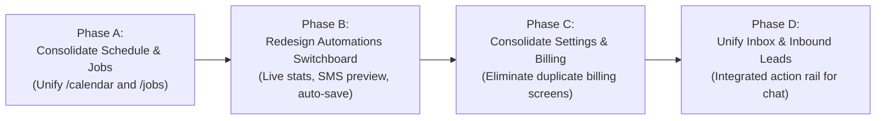

# Comprehensive Senior UX, UI & Product Designer Audit: CaptoDesk Platform

**Auditor:** Principal Product Designer & Design Architect (Home Services & Vertical SaaS)  
**Target:** CaptoDesk / Corvexa Platform (`https://app.corvexastudio.com`)  
**Design Standard:** Industrial Precision, Quiet Utility, Truck-First Ergonomics (48px+ touch targets), Zero AI Clichés, Zero Tutorial Bloat.

---

## Executive Summary & Core Architectural Diagnosis

Contractors, solo technicians, and field service dispatchers do not use software like desk-bound corporate workers. They operate in sunlight, from truck cabs, with dusty hands, between job sites, under high pressure.

When analyzing the 12 inside sections of the platform, **one root structural flaw emerged across multiple screens**:

> **"Feature Bloat via Side-by-Side Duplication"**  
> Instead of building unified, contextual workflows, features were created as separate standalone pages with overlapping responsibilities. Contractors are forced to ask:
> * *"Do I check Calendar or Jobs to see where I go today?"*
> * *"Do I check Inbox, Leads, or Activity to see who reached out?"*
> * *"Do I manage my plan in Settings or in Billing?"*
> * *"Is Field Portal different from Today's Command Center?"*

### Overall Section Verdict Matrix

| Section | Current Route | Senior Designer Verdict | Primary Reason |
| :--- | :--- | :--- | :--- |
| **1. Today (Command Center)** | `/client/dashboard` | **Major Overhaul** | High potential; needs cleaner hierarchy, truck-speed summary, and zero marketing copy. |
| **2. Inbox & Customer Chat** | `/client/inbox` | **Major Overhaul** | Unify with Leads & Activity; make conversation pane frictionless with 1-tap quote/job dispatch. |
| **3. Schedule (Calendar)** | `/client/calendar` | **Redesign Completely** | Merge with `Jobs` into a single, cohesive **"Schedule & Dispatch"** hub (Agenda / Calendar / Map). |
| **4. Jobs (Work Orders)** | `/client/jobs` | **Redesign Completely** | Eliminate redundant route/calendar duplication; transform into the "List & Route" view of Schedule. |
| **5. Quotes (Estimates)** | `/client/quotes` | **Targeted Polish** | Core flow is solid; eliminate PostgREST errors, streamline line-item entry, add instant 1-tap SMS send. |
| **6. Invoices & Payments** | `/client/invoices` | **Targeted Polish** | Table and metrics are clear; streamline "Record Offline Payment" modal and payment link generator. |
| **7. Reviews & Retention** | `/client/reviews` | **Redesign Completely** | Merge Google Review management and automated win-back reactivation into an authentic **"Reputation & Growth"** engine. |
| **8. Customers (CRM)** | `/client/customers` | **Targeted Polish** | Directory is fast and well-structured; improve mobile card density and unify detail drawer. |
| **9. Service Catalog** | `/client/services` | **Targeted Polish** | Good pricing model badges; streamline card layout density and remove tiny toggle switches. |
| **10. Team & Fleet** | `/client/team` | **Major Overhaul** | Currently over-engineered for solo operators; needs contextual role switching (Solo mode vs Multi-Crew mode). |
| **11. Automations** | `/client/automations` | **Redesign Completely** | Currently a static vertical stack of 5 rules with long text; transform into a high-visibility **"Automation Switchboard"** with live trigger stats. |
| **12. Settings & Billing** | `/client/settings` & `/billing` | **Redesign Completely** | Split identity: Billing lives in both places. Unify Billing into Settings; streamline tabs into 4 clear categories. |
| **13. Field Portal (Sub-view)** | `/client/field` | **Integrate into "Today"** | Excellent mobile-first execution, but currently siloed; should seamlessly power the mobile view of "Today". |

---

## Detailed Section-by-Section Audit & Redesign Blueprints

```mermaid
flowchart TD
    subgraph CURRENT_MESSY_STRUCTURE["Current Fragmented Architecture (12+ Separate Menu Items)"]
        D1["Today (/dashboard)"]
        D2["Field Portal (/field)"]
        D3["Calendar (/calendar)"]
        D4["Jobs (/jobs)"]
        D5["Inbox (/inbox)"]
        D6["Leads (/leads)"]
        D7["Activity (/activity)"]
        D8["Quotes (/quotes)"]
        D9["Invoices (/invoices)"]
        D10["Settings (/settings)"]
        D11["Billing (/billing)"]
        D12["Reviews (/reviews)"]
    end

    subgraph STREAMLINED_STRUCTURE["Senior Designer Recommended Unified Architecture (6 Core Pillars)"]
        U1["Today & Field Route\n(Truck-Ready Command Center)"]
        U2["Schedule & Jobs\n(Unified Calendar / Dispatch / List)"]
        U3["Inbox & Inbound\n(Messages + Missed Calls + Leads)"]
        U4["Money (Quotes & Invoices)\n(Single Financial Lifecycle)"]
        U5["Customers & Services\n(Directory + Trade Catalog)"]
        U6["Business Hub\n(Reviews + Automations + Settings)"]
    end

    D1 --> U1
    D2 --> U1
    D3 --> U2
    D4 --> U2
    D5 --> U3
    D6 --> U3
    D7 --> U3
    D8 --> U4
    D9 --> U4
    D10 --> U6
    D11 --> U6
    D12 --> U6
```

---

### Section 1: Today / Command Center (`/client/dashboard`)

#### 1. Mental Model & Purpose
The contractor's morning launching pad. When opening the app at 7:00 AM in the driveway, they need answers to 3 questions in 3 seconds:
1. *Where am I going first and at what time?*
2. *Did any urgent missed calls or online bookings arrive overnight?*
3. *How much cash came in yesterday, and what is due today?*

#### 2. Current UX/UI Flaws & Friction Points
- **Verbose Educational Copy:** Historically plagued by explanatory badges (*"Truck Command Active"*, *"3-Sec Missed Call Auto-Text"*). We cleaned the field schedule card, but the rest of the page still contains redundant sub-headers.
- **Disconnected Field Execution:** While `/client/field` has great big 48px buttons (`[ Start Route ]`, `[ Arrived ]`, `[ Take Photos ]`), the desktop dashboard only renders a static schedule list. When on a phone, `/client/dashboard` should automatically adapt into the Field Portal ergonomics instead of feeling like a separate app.
- **Metric Clutter:** 4 top cards show Revenue, Booking Rate, Missed Calls, and Active Jobs. Revenue lacks context (is it this week? this month? all time?).

#### 3. Verdict: `Major Overhaul`
Transform from a generic analytics dashboard into an **Operational Dispatch Cockpit**.

#### 4. Redesign Blueprint
- **Layout (Mobile-First):**
  - **Top Bar:** Business status indicator (Live Phone Number, Missed Call Auto-Text Active indicator), Profile, Quick Action `[ + ]`.
  - **Hero Card (Truck Route):** Next scheduled job in high-contrast card: Customer Name, Address (with 1-tap Google Maps link), Scheduled Time window, Call Customer button, and primary status CTA (`[ En Route ]` or `[ Complete Job ]`).
  - **Secondary Grid:** 
    - Left: Inbound Urgent Queue (Missed calls awaiting callback, new online booking requests).
    - Right: Financial Pulse (Unpaid invoices due today, Approved quotes ready to schedule).
- **Copy Polish:** Zero tutorial text. Use trade nouns: *"Next Appointment"*, *"Open Quotes"*, *"Awaiting Payment"*.

---

### Section 2: Inbox & Customer Chat (`/client/inbox`)

#### 2. Mental Model & Purpose
The conversational nerve center. Holds two-way SMS with homeowners, automated missed-call text logs, booking confirmations, and customer questions.

#### 2. Current UX/UI Flaws & Friction Points
- **Triple Inbound Siloing:** We currently have `/client/inbox`, `/client/leads`, and `/client/activity`. Homeowners reaching out end up in three different places depending on how they reached out.
- **Thread Density:** The left conversation sidebar is too cramped on tablets and lacks prominent phone badges or urgency indicators.
- **Missing Action Rails in Chat:** When chatting with a customer who says *"Yes, please come by tomorrow at 2 PM"*, the technician has to leave the conversation, go to Calendar, click Create Job, and re-type the customer's info.
- **Desktop Chat Window:** Uses generic chat bubbles with excessive whitespace; lacks customer sidebar showing previous job history, address, and equipment notes.

#### 3. Verdict: `Major Overhaul`
Absorb `/client/leads` and `/client/activity` directly into **Inbox**, making it the single source of truth for all customer communications.

#### 4. Redesign Blueprint
- **3-Pane Desktop Layout / 2-Step Mobile Flow:**
  - **Pane 1 (Channels & Filters):** Simple pills: `All Messages`, `Unread`, `Leads (New Inquiries)`, `Missed Calls`.
  - **Pane 2 (Conversation List):** Customer Name, Time elapsed (e.g. `12m ago`), Trade badge or service tag, message snippet, and unread indicator.
  - **Pane 3 (Active Conversation & Action Header):**
    - **Persistent Action Bar at Top of Thread:**
      - `[ Call Customer ]` (Telnyx dialer)
      - `[ + Create Quote ]` (pre-fills customer ID and recent thread context)
      - `[ + Book Job ]` (pre-fills address and time)
    - **Right Rail (Collapsible):** Customer Profile Mini-Card (Address, gate code, lifetime spend, link to full CRM profile).

---

### Section 3 & 4: Schedule (`/client/calendar`) & Jobs (`/client/jobs`)

#### 1. Mental Model & Architectural Conflict
This is the single biggest point of confusion in the app.
- `/client/calendar` has Day, Week, Month, Agenda, and Dispatch views.
- `/client/jobs` has a table of jobs, status filters, crew assignments, and a button that says *"Calendar View"*.
- *Contractor perspective:* **A job is an appointment, and an appointment is a job.** Having two separate primary navigation menu items for the exact same entity creates a fractured mental model.

#### 2. Current UX/UI Flaws
- **`jobs/page.tsx` (1,338 lines):** Renders a dense tabular list that requires horizontal scrolling on mobile. Clicking a job opens a generic modal instead of a rich job drawer.
- **`calendar/page.tsx` (1,888 lines):** Over-engineered with too many secondary toggles (Crew filters, Google Calendar sync alerts, color pickers, time slot height controls).
- **Status Inconsistency:** "En Route", "In Progress", "Completed" buttons exist on both pages but behave with different modals and state updates.

#### 3. Verdict: `Redesign Completely (Consolidate into "Schedule & Jobs")`
Unify `/client/calendar` and `/client/jobs` into one premier module: **"Schedule"** (with `/client/jobs` permanently redirecting or aliasing to the unified view).

#### 4. Redesign Blueprint
- **Unified Navigation Tabs at Top of Schedule:**
  - `[ Calendar (Day/Week/Month) ]` | `[ Dispatch List (Jobs) ]` | `[ Crew Board ]` | `[ Map View ]`
- **Solo vs Multi-Crew Adaptive UX:**
  - If the account has only 1 technician (Solo tier), automatically hide the multi-crew lane switcher and default to the clean single-truck Agenda view.
  - If the account has multiple crews (Fleet tier), activate the horizontal technician swimlanes.
- **Drawer-First Job Detail:**
  - Clicking any appointment/job on the calendar or in the list opens a clean, slide-out 480px **Job Action Drawer**:
    - Customer Info & 1-tap navigation link (`Waze` / `Apple Maps` / `Google Maps`).
    - Job Status pills (`Scheduled` -> `En Route` -> `In Progress` -> `Completed`).
    - Line Items & Quote Link.
    - Before / After photo gallery upload with camera capture.
    - 1-tap `[ Generate Invoice ]` button upon completion.

---

### Section 5: Quotes / Estimates (`/client/quotes`)

#### 1. Mental Model & Purpose
Where contractors estimate work, calculate costs, and send professional digital quotes via SMS/Email to homeowners for 1-tap approval and deposit.

#### 2. Current UX/UI Flaws & Friction Points
- **PostgREST Multiple Relationship Bug:** We just resolved the foreign key conflict between `quotes` and `jobs`, but the error exposed that the API was brittle.
- **Modal vs Full Page:** Creating a quote currently happens inside a heavy multi-step modal (`<Modal size="xl">`). Adding multiple line items, materials, and labor with small inputs inside a modal feels cramped.
- **Public Quote View Disconnect:** Homeowners receiving a quote link should have a frictionless, mobile-optimized signing experience (Approve, Sign with Finger, Pay Deposit via Card/Apple Pay). The link generation button in the list is currently buried in a three-dots menu.

#### 3. Verdict: `Targeted UX & Ergonomics Polish`
The foundation of Quotes is strong. It needs ergonomics improvements rather than a ground-up rewrite.

#### 4. Redesign Blueprint
- **Primary Metrics Bar (Streamlined):**
  - Replace 4 cards with 3 clear summary tokens: `Active Estimates ($)`, `Pending Approval (Count)`, `Won This Month (%)`.
- **Slide-out or Dedicated Route for Quote Builder:**
  - Instead of a cramped modal, use `/client/quotes/new` or a full-width drawer.
  - Auto-complete service items directly from the **Service Catalog** (1-tap adds name, description, and standard rate).
  - Explicit Deposit Toggle: *"Require 50% deposit upon signature"* with instant Stripe/PayPal calculation.
- **1-Tap Share Bar:** Directly on every quote card in the list, provide an instant `[ Send via SMS ]` button with a preview of the homeowner's text message.

---

### Section 6: Invoices & Payments (`/client/invoices`)

#### 1. Mental Model & Purpose
Getting paid. Once a job is finished, the technician converts the job/quote to an invoice, sends the payment link, or collects cash/check on-site.

#### 2. Current UX/UI Flaws & Friction Points
- **Disconnected from Quotes:** An invoice is the natural conclusion of an approved quote. Currently, creating an invoice requires manual entry unless triggered from the job card.
- **"Record Offline Payment" Friction:** In home services, 30%+ of payments are checks or cash on-site. The record payment action is hidden inside an action dropdown instead of being an immediate 48px touch target.
- **Table Density on Mobile:** On phones, the invoices table collapses into basic cards, but lacks instant swipe actions (e.g. Swipe to Resend Link, Swipe to Mark Paid).

#### 3. Verdict: `Targeted UX & Ergonomics Polish`

#### 4. Redesign Blueprint
- **Status Filter Pills (Linear/Stripe Style):**
  - `All` | `Unpaid (Overdue & Due)` | `Paid` | `Drafts`
- **Instant "Collect Payment" Modal:**
  - Two large primary buttons:
    - `[ Send Digital Payment Link (SMS) ]`
    - `[ Mark Paid via Cash / Check / Zelle ]` (instantly generates receipt and closes invoice).
- **Direct Receipt Generation:** Automatic PDF and SMS receipt sent to homeowner with Google Review link embedded at the bottom.

---

### Section 7: Reviews & Retention (`/client/reviews`)

#### 1. Mental Model & Purpose
Local home service businesses thrive or die by their Google Maps rating and repeat seasonal service (e.g. AC checkups, drain cleanings).

#### 2. Current UX/UI Flaws & Friction Points
- **Current File Complexity (1,030 lines):** Contains long educational blurbs on why 5-star Google reviews boost local SEO.
- **Siloed Retention Engine:** Customer reactivation reminders are currently split between `/client/automations`, `/client/customers` ("Run Reactivation" button), and `/client/reviews`.
- **Lack of Direct Response Workflow:** Shows Google reviews, but replying to them or seeing which customer never received a review invite requires manual inspection.

#### 3. Verdict: `Redesign Completely (Transform into "Reputation & Growth")`

#### 4. Redesign Blueprint
- **Two Clean Sub-Tabs:**
  1. `Google Reviews & Feedback` (Live rating, review stream, 1-tap template replies)
  2. `Automated Review Booster` (SMS review invite queue, send history, conversion rate)
- **Top Summary Card:**
  - Google Star Rating with total count (e.g. `4.9 ★ (142 Reviews)`).
  - Monthly Review Velocity (e.g. `+18 this month`).
  - Google Review Shortlink with 1-click test and QR code generator (for technicians to show on their phones at the front door).
- **Pruned Copy:** Remove all marketing lectures. Focus 100% on operational review dispatch.

---

### Section 8: Customers / CRM (`/client/customers`)

#### 1. Mental Model & Purpose
The client directory. Address, phone number, gate codes, service frequency, equipment history (e.g. 50-gal water heater installed in 2023), and lifetime value.

#### 2. Current UX/UI Flaws & Friction Points
- **"Run Reactivation" Button Placement:** Currently sits as an awkward button in the header with a magic wand icon, triggering a backend POST to `/api/client/retention`. It belongs in Automations or Growth, not above the customer search bar.
- **Customer Detail Screen (`/client/customers/[id]`):** Too many nested tabs with empty states. For a solo plumber, looking up a customer should show their address, equipment notes, and job history in a clean, scrollable feed.

#### 3. Verdict: `Targeted UX & Ergonomics Polish`
The customer table with CSV export, search, and lifetime value calculation is well-built. Just refine the visual ergonomics.

#### 4. Redesign Blueprint
- **Header:** Clean Search Bar (searches by Name, Phone, Address, or Equipment), `[ + Add Customer ]`, and `[ Export CSV ]`.
- **Relocate Reactivation:** Move bulk retention triggers into Automations / Reviews.
- **Refined Customer Detail:** Combine Notes, Equipment Info, and Past Jobs into a unified chronological timeline (like a medical chart for the home).

---

### Section 9: Service Catalog (`/client/services`)

#### 1. Mental Model & Purpose
The price book. Services offered, standard durations, flat rates vs diagnostic fees vs free estimates, and online booking toggles.

#### 2. Current UX/UI Flaws & Friction Points
- **Card Clutter:** The service cards display 5+ different badge types with varying background tints.
- **Toggle Touch Targets:** The activate/deactivate toggle is a tiny 16px button with a spinner that is difficult to tap on mobile.
- **"Load Trade Catalog" Modal:** Excellent feature (imports 15-20 pre-configured trade services in 60 seconds), but its modal UI looks like a raw data table.

#### 3. Verdict: `Targeted UX & Ergonomics Polish`

#### 4. Redesign Blueprint
- **View Toggle:** Allow switching between `Card Grid` and dense `Table View` (for rapid price editing).
- **Standardized Badge System:**
  - Clean monochrome tags: `Fixed $189`, `Starting at $89`, `Diagnostic $99`, `Free Estimate`.
- **48px Toggle Switch:** Standard iOS/Linear-style switch that clearly indicates Active vs Inactive with high contrast.

---

### Section 10: Team & Fleet (`/client/team`)

#### 1. Mental Model & Purpose
Staff directory, user invites (Admin, Dispatcher, Technician), and multi-van dispatch crews.

#### 2. Current UX/UI Flaws & Friction Points
- **Solo vs Fleet Cognitive Dissonance:** For a solo owner (which represents 70%+ of signups), landing on Team & Fleet shows empty crew performance metrics, dispatch broadcast buttons, and upgrade banners that feel irrelevant.
- **Role Permissions Opacity:** Hard to understand the exact difference between "Dispatcher" and "Technician" until an invite is sent.

#### 3. Verdict: `Major Overhaul (Role & Tier Contextual Adaptation)`

#### 4. Redesign Blueprint
- **Contextual State:**
  - **Solo Operator Mode:** Renders a clean "My Profile & Field Credentials" page. Shows your connected phone number, vehicle/license details, and an unobtrusive card: *"Ready to add your first helper or truck? Upgrade to Fleet"*.
  - **Fleet / Multi-Crew Mode:** Activates the full Crew & Technician Dispatch Board with GPS route assignment and role management.
- **Role Permissions Card:** Clear 3-column visual matrix showing exactly what Technicians, Dispatchers, and Admins can see and edit.

---

### Section 11: Automations (`/client/automations`)

#### 1. Mental Model & Purpose
The 24/7 autopilot. When the contractor is on a ladder and misses a phone call, this engine texts the homeowner in 3 seconds to keep them from calling the next competitor on Google.

#### 2. Current UX/UI Flaws & Friction Points
- **Giant Vertical Stack (25 KB of JSX):** 5 rules are displayed as huge individual cards stacked down a long page.
- **Awkward Save Model:** Editing a text template inside Rule 1 requires scrolling all the way back to the top-right of the page to hit *"Save Rules"*. If the user navigates away, changes are lost.
- **No Live Performance Signals:** There is no indication of how many times each automation fired today, this week, or all time.

#### 3. Verdict: `Redesign Completely`

#### 4. Redesign Blueprint
- **Automation Control Switchboard (Linear / Stripe Style):**
  - **Summary Row:** `Automations Active (4/5)` | `Texts Sent Today (12)` | `Leads Saved (3)`.
  - **Rule Cards (Accordion or Drawer Configuration):**
    - **Row 1:** ⚡ **Missed-Call Instant Text-Back** (Status Toggle: `Active`, fires within 3 seconds, preview bubble of SMS message).
    - **Row 2:** ⭐ **Post-Job Google Review Request** (Status Toggle: `Active`, triggers 30m after job completion).
    - **Row 3:** 📅 **Upcoming Appointment Reminder** (Status Toggle: `Active`, triggers 24h & 2h before arrival).
    - **Row 4:** 📋 **Quote Expiration & Follow-Up** (Status Toggle: `Active`, triggers 48h after quote sent).
    - **Row 5:** 🔄 **Customer Seasonal Reactivation** (Status Toggle: `Active`, triggers 6-9 months post-service).
- **Inline Auto-Save:** Every field autosaves with a quiet `Saved ✓` indicator. Zero top-level global save buttons.
- **Live SMS Preview Widget:** Side-by-side interactive mobile screen showing how the template variables (`{business_name}`, `{booking_url}`) render on an iPhone.

---

### Section 12: Settings & Billing (`/client/settings` & `/client/billing`)

#### 1. Mental Model & Architectural Conflict
- `settings/page.tsx` has 7 tabs: `Business Profile`, `Subscription & Plans`, `Theme & Display`, `Telephony & Routing`, `Retention & 10DLC`, `Customer Payments`, `Alerts & Push`.
- `/client/billing` is a separate route with PayPal SaaS plan upgrades, invoices, and billing history.
- Users looking to update their credit card or change their plan are caught between Settings Tab 2 and the separate Billing page.

#### 2. Current UX/UI Flaws & Friction Points
- **Tab Overload in Settings:** 7 horizontal tabs create horizontal scrolling on tablets and mobile, making settings hard to navigate.
- **Duplicate Subscription UI:** Both pages make independent API calls to fetch plan details and render different UI components for the exact same data.

#### 3. Verdict: `Redesign Completely (Consolidate into Unified Settings)`

#### 4. Redesign Blueprint
- **Merge Billing Permanently into Settings:** Delete the standalone `/client/billing` navigation item; make it `/client/settings?tab=billing` (with automatic 301 redirect).
- **Consolidate into 4 Logical Groups:**
  1. **Business & Team:** Company Name, Phone, Address, Trade, Team Members.
  2. **Billing & Plan:** Current Plan, Payment Method, Invoices, Upgrade/Downgrade.
  3. **Phone & 10DLC Compliance:** Telnyx Number, Call Forwarding, Carrier Registration Status.
  4. **Payments & Invoicing:** Homeowner Payment Links (Stripe / PayPal / Zelle / Venmo), Tax Rates, Terms.
- **Mobile Navigation:** Vertical accordion list on mobile instead of an overflow horizontal scrollbar.

---

### Section 13: Field Portal (`/client/field`)

#### 1. Mental Model & Purpose
The technician's in-truck companion. Big buttons, high contrast, GPS navigation links, photo capture, and job status transitions.

#### 2. Current UX/UI Flaws & Friction Points
- Currently treated as a "hidden" sub-page or alternate role view. For solo contractors who do both dispatch and field work, having to switch back and forth between "Today" and "Field Portal" is clunky.
- Great buttons (`[ Start Route ]`, `[ Arrived ]`), but lacks quick access to customer chat history when the technician needs to ask *"Where is the lockbox?"*.

#### 3. Verdict: `Integrate Directly into Today's Mobile Experience`
- When a user opens `/client/dashboard` on a mobile device or tablet, the **Field Route Card** should be the prominent hero component with full access to the 48px touch actions.
- Add an instant `[ Text Customer ]` quick-action button directly on the field card.

---

## Action Plan & Implementation Phases

Based on this audit, here is the prioritized redesign roadmap:

1. **Phase A: Schedule & Jobs Unification (Highest Impact)**
   - Unify `/client/calendar` and `/client/jobs` into one comprehensive **Schedule & Jobs** center.
   - Introduce the unified slide-out **Job Detail Drawer** with 48px field actions.
2. **Phase B: Automations Redesign (Immediate Polish)**
   - Replace the 25 KB vertical card stack with the clean **Automation Switchboard**.
   - Add inline autosave and the live phone preview.
3. **Phase C: Settings & Billing Consolidation (Eliminate Confusion)**
   - Merge `/client/billing` cleanly into `/client/settings?tab=billing`.
   - Prune the 7 tabs into 4 well-structured categories.
4. **Phase D: Inbox & Inbound Communication Unification**
   - Absorb `/client/leads` into the Inbox filter rail.
   - Add the persistent `[ Create Quote ]` and `[ Book Job ]` action bar at the top of active SMS threads.
